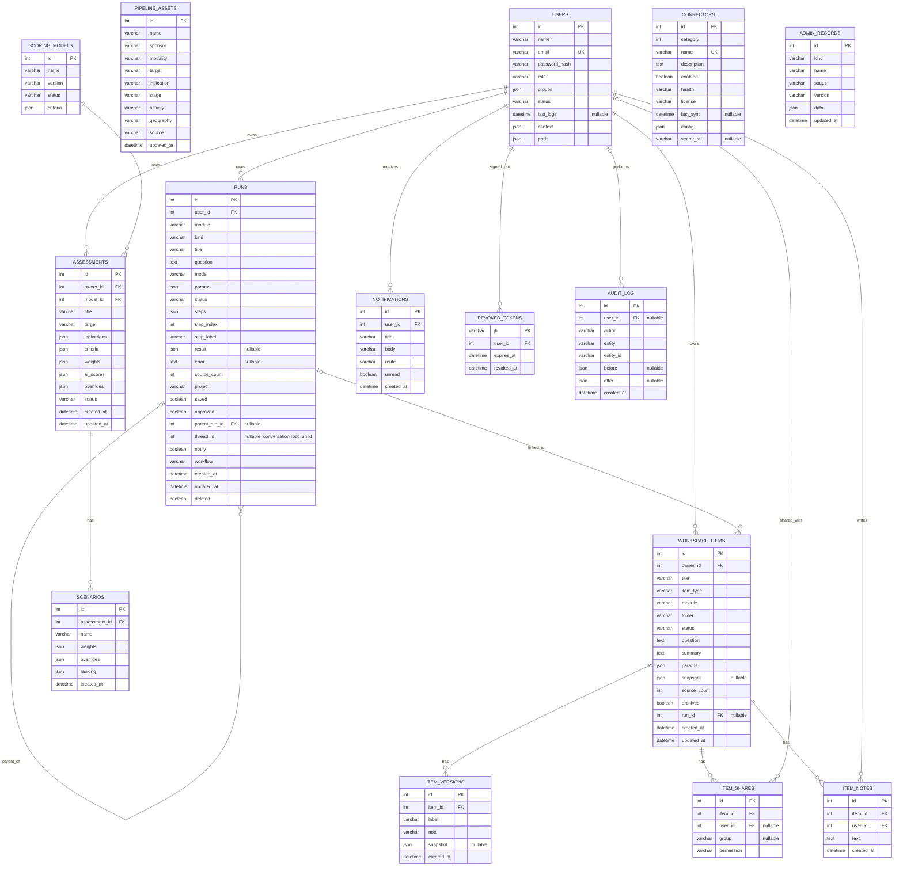

# Database ER Diagram

This diagram reflects the SQLAlchemy tables and declared foreign keys in
[`app/db/models.py`](./app/db/models.py).

`pipeline_assets`, `connectors`, and `admin_records` have no declared foreign
keys. IDs embedded in JSON values (such as `assessments.overrides`) are not
foreign-key relationships in the schema.
