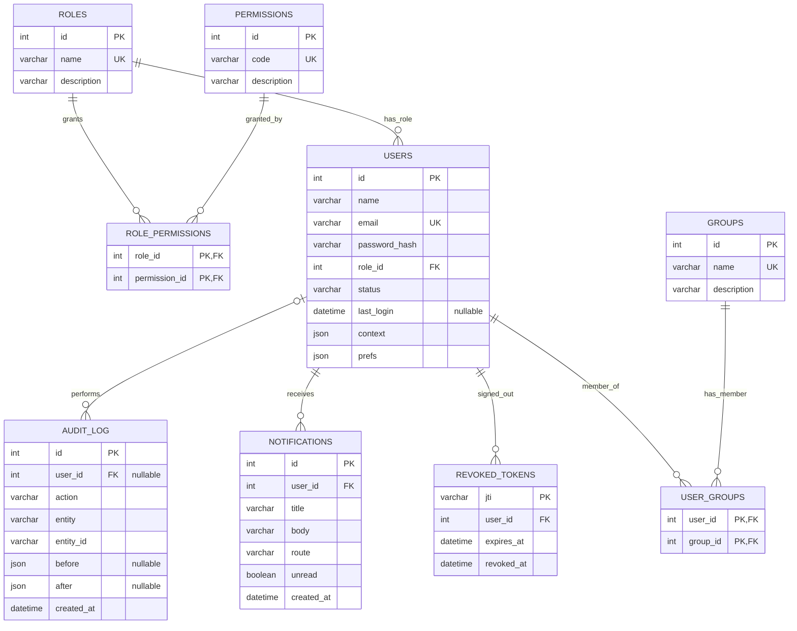
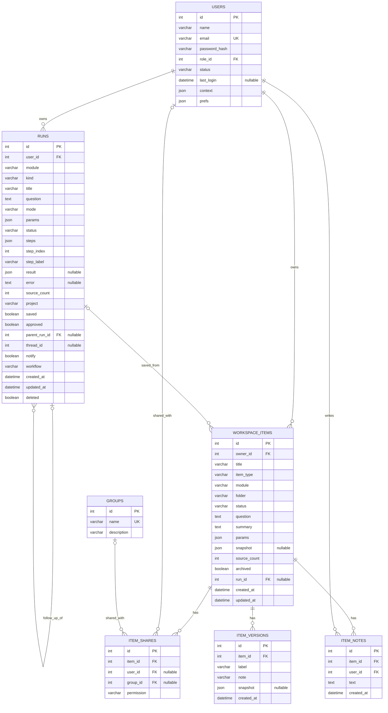
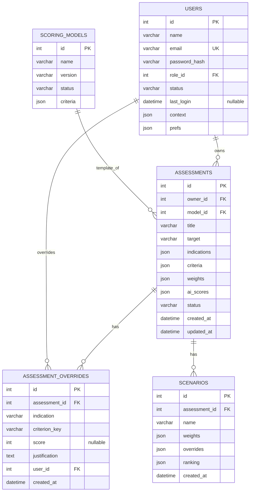
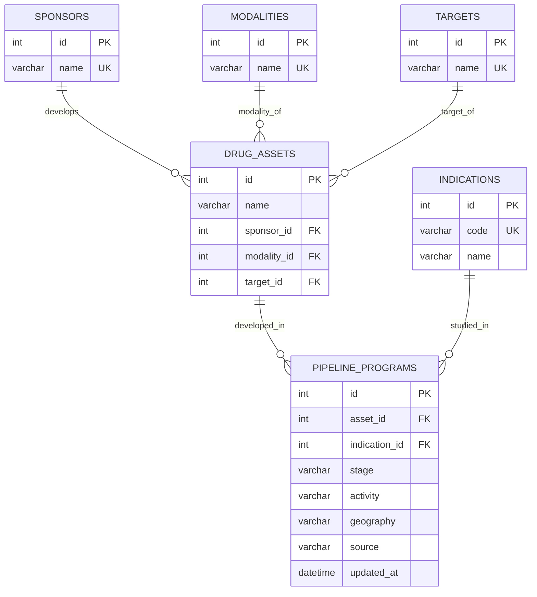
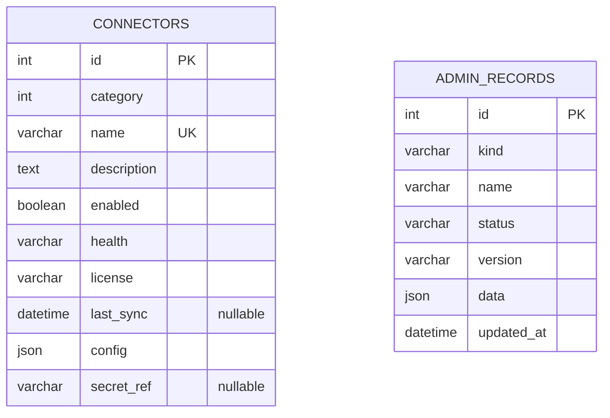

# Database ER Diagram

Entity-relationship diagrams for the platform database, grouped by domain.
26 tables. Keys: PK primary key, FK foreign key, UK unique. `||--o{` = one-to-many (required), `o|--o{` = optional parent.

A full guide with descriptions, JSON shapes and database commands is in [`docs/Database_ER_Guide.pdf`](./docs/Database_ER_Guide.pdf).

## Identity & access

## Research runs & workspace

## Prioritization scoring

## Pipeline catalogue

## Configuration (no foreign keys)

## Notes

- `users` and `groups` appear in several diagrams because many domains reference them.
- `runs.thread_id` groups the turns of a conversation (the first turn's id). It is a logical link without a foreign-key constraint.
- `role_permissions` and `user_groups` are many-to-many link tables with composite primary keys.
- An `item_shares` row targets either a user (`user_id`) or a group (`group_id`), never both.
- `assessment_overrides.indication` / `criterion_key` refer to values inside the assessment's own `indications` / `criteria` JSON (the assessment is a working copy of a scoring model).
- JSON columns hold snapshots and flexible payloads (run params/results, saved snapshots, scenario snapshots, criteria templates, user context and preferences). IDs inside JSON are not enforced by the database.
